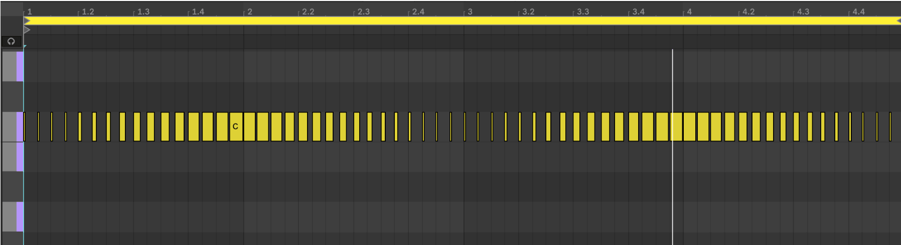

持续记录混音的灵感与经验。无固定格式，一般不涉及具体软件或插件的操作方式，更多是方法性的总结：归纳如何用最基础的数字效果器，通过路由和调制来组合出特定的音色或效果。

## 雕刻长音纹理

Pad 适合铺设情绪底色，但长时值容易让编曲显得拥挤；混响尾音空间感强，连贯过久会模糊层次；共鸣器的反馈回路会把瞬态拉长成弥散的共振尾音；Drone 音乐若只有平铺、黏稠的缓慢渐变，容易显得单调。

我更喜欢挑选部分长音进行切片/断续/颗粒化处理，这样既能部分保留长音原有的特征，又能为织体拆出呼吸感与层次，悄悄增强编曲的纵深与纹理感。

为了实现以上效果，需要把调制信号接到对应的控制参数上。一些常见的调制对象包括：门限的通断、滤波器的截止频率 / 谐振强度、失真类效果的 Drive 量 / 直流偏移量、延迟/混响效果的时间 / 无限延音开关，甚至是采样播放点位置……

以下是我偏好的几种具体落地方式——

### 步进音序法

Bitwig 自带 `Steps`、`ParSeq-8` 两种步进调制器，其他 DAW 一般也允许绘制自定义的阶梯状 LFO ；此外，有些效果插件还内置了步进音序器，可一站式完成处理：

> - [Illformed :: Glitch²](https://illformed.com/)
> - [FILTERSTEP 2 by Audiomodern™](https://audiomodern.com/shop/plugins/filterstep/)
> - [HY-ESG](https://bpb.gumroad.com/l/hy-esg/HYESGFREE)
> - [Kilohearts - Trance Gate](https://kilohearts.com/products/trance_gate)

除了常规用法，还可进一步对步进音序器的参数进行自动化设置或调制，例如改变一步的音符时值、整体步数等等，制造更加复杂的非标准律动。

### PWM侧链法

合成器的 PWM（脉冲宽度调制，Pulse Width Modulation）通常用来调制方波振荡器的占空比，动态改变其谐波结构，常用于构建复古弦乐、Pad 以及厚实的 Lead 音色。

以此为灵感，将 PWM 的调制对象从振荡器波形的占空比推广到 LFO 的占空比，再进一步以这个 PWM LFO 去调制合成器或者效果器的任意参数，即可赋高度重复的律动以流动感。

目前各大调制系统中，原生支持动态改变占空比的 LFO / 步进音序调制器非常罕见。一种通用的方法是用一个简单的 LFO 调制固定周期 MIDI 信号的音符长度/门限长度，再以这个经过 PWM 的 MIDI 作为侧链调制想要控制的参数：

1. 在辅助音轨放置一个 步进音序器 / 琶音器 / MIDI重复工具，以一定的周期产生 MIDI 音符。
2. 用一个 LFO 调制 步进音序器 / 琶音器 / MIDI重复工具 的「**Gate / Note Length**」参数，就得到了一轨经过 PWM 的 MIDI 信号。 
3. 在 Bitwig Studio 中，可以直接用这个 PWM MIDI 触发被调制插件的 MIDI 侧链。
4. 在任何 DAW 中，都可以继续在这个辅助音轨载入一个 Attack=Release=0、Sustain=1 的合成器，来生成 PWM 的白噪音脉冲，然后用它去触发被调制插件的音频侧链。

### 欠压法兹

欠压法兹（Starved Fuzz）是法兹效果在供电不足时的异常工作状态，表现为尾音衰减时声音发碎，还会没规律地时断时续。把这种效果放在混响**后面**，混响的高频会被法兹炸开，尾音会被切得断断续续，为编曲增添充满破碎感的 lo-fi 纹理。

模拟欠压法兹，要先从模拟一个正常工作的法兹开始。信号链为：直流偏移 → 硬削波 → 消除直流偏移。这三步可以通过在通用的数字失真插件中把 Drive 开到很高，再设置一定的 Bias / DC Offset 直接获得。

以此为基础，存在两种模拟欠压法兹断续感的信号链：

- 法兹 → 噪声门：噪声门参数跟正常反着来，向最不自然的方向设置，attack、release尽量调小、knee与hold归零，Threshold找一个能让卡顿频繁产生的临界点，干声经过混响平滑与法兹重度削波，往往已经没什么动态了，找到这样的临界点通常不难，地域阈值关门时不用完全静音，只衰减十几分贝反而更像。
- Bitcrusher → 法兹：操作非常简单，把位深压低到 4 到 8 bit 之间，依靠量化失真的台阶状动态，即可制造出类似欠压法兹的断续感。

### 粒子合成

粒子合成也是拆解与重组纹理的一种常见方式，目前我在这块还没有太多实践经验，等后续摸索得更熟再补充。

## 瞬态分离

核心思路：将声音拆分成 **Transient（起音/瞬态）** 与 **Sustain（延音/稳态）** 分别处理。

### 叠音色

以双音源叠 Bass 为例。

- **触弦**：用谐波丰富的音源（锯齿/方波减法或 FM、物理建模）做质感，借 Transient EQ 保留瞬态全频、衰减延音段低频并保留中高频色彩，规避传统分频的中低频掩蔽或衔接空洞
- **下潜**：用正弦/三角波，Attack包络比常规略慢，以触弦轨侧链触发 Transient Shaper 压低延音起音让位，注意低频突然切断容易产生 click 咔哒声，因此瞬态塑形器最好具备前瞻（lookahead）功能，若缺少该功能，也可手动后移延音轨数毫秒提前衰减；
- **融合**：在双音源合并的编组用压缩粘合，并统一做避让底鼓、发送混响等处理。

### 混响

瞬态的混响侧重于形成空间感，稳态的混响则更多起到塑造氛围与音色的作用。

有时，如果直接将完整的乐器干声发送给混响，容易产生较强的打击感；若切除瞬态只把延音送进混响，就能放心把混响推大，将钢琴等长 Decay 类乐器塑造成更具空灵感的音色。

这种稳态混响还可作进一步处理：例如在混响前加上音高调制，做出超现实的感觉；或者在混响后加上欠压法兹（用干声的动态触发），配合合理的失真干湿比，能营造既平稳又破碎的矛盾感。

### 延迟

可在延迟效果器的 feedback 回路内部，或发送轨的延迟效果器前放置 Transient Shaper。

- 衰减音头可让每次进入延迟的起音更柔和，容易形成绵密的氛围感
- 衰减延音可削弱延迟的拖沓感、凸显颗粒

### 染色

有些饱和效果器支持调节瞬态/稳态的染色比例。

- 偏向瞬态的染色可强化起音咬劲、颗粒感与存在感，收敛瞬态尖峰的同时减少长尾或低频因过量谐波变糊，保持延音干净；
- 偏向稳态的染色则能为延音或主体增加厚度、谐波密度与肉弹感，同时避免起音被过度削平或染得发硬。

### Tremolo

普通 Tremolo 会让音头瞬态变糊——这在有时是符合期望的效果，有时则恰恰与期望相反——此时可将信号做 T/S 分离并只对延音施加 Tremolo，既能保留起音清晰度，又能让尾音产生起伏。

## 硬件压缩器的动态特性

这种方法可在不引入音染的情况下用数字压缩器模拟硬件压缩器的动态特性，让动态类效果专门负责动态，饱和类效果专门负责谐波。数字类效果的精髓不在于精准还原硬件，而在于可针对具体素材的需求量身定做，表中数值仅供参考，可按实际需求灵活修改。

|         | Opto                                                                                                                                            | Vari-Mu                                                                       | FET                                                                      |
| ------- | ----------------------------------------------------------------------------------------------------------------------------------------------- | ----------------------------------------------------------------------------- | ------------------------------------------------------------------------ |
| Knee    | 30dB~∞（越高越好）                                                                                                                                    | 30~45dB                                                                       | 10~1dB                                                                   |
| Ratio   | 20:1~∞                                                                                                                                          | 20:1~30:1                                                                     | 4:1~20:1                                                                 |
| Attack  | 10ms左右                                                                                                                                          | 初始数十毫秒，随Peak包络逐渐压低到毫秒量级                                                       | 0.02~0.8ms                                                               |
| Release | 初始100ms左右，RMS包络稍增长就延长到1秒左右（对数调制）                                                                                                                | 初始100ms左右，随RMS包络能量逐渐延长到数秒量级                                                   | 50ms~1.1s                                                                |
| 数字改良思路  | 1.可在检测侧链添加高通滤波器，以减少抽吸感； 2.可在后方串联轻度工作的 soft clipper 或 limiter，以控制压缩漏掉的过强瞬态； 3.若超宽 knee 导致压缩过多，可在压缩前降低几dB电平来等效「正数电平的 Threshold」，压完再把电平补偿回来。 | 1.可在检测侧链添加高通滤波器，以减少抽吸感； 2.可在后方串联轻度工作的 soft clipper 或 limiter，以控制压缩漏掉的过强瞬态。 | 1.推荐开启 lookahead 以减少极短 attack 的失真； 2.可在检测侧链添加高通滤波器，或者调整整体的干湿比，以减少抽吸感。 |

## 环绕运动

专业影视/游戏精确还原空间定位需要依赖完整的 HRTF 空间系统，而传统的立体声音乐大致模拟空间运动就不一定要这么精确，用简单的低通滤波、混响、声像自动化也能模仿出大致的运动趋势。

- 信号链：低通滤波器 -> 早反射混响 -> 声像
	- 混响选择定位感较强的Room类型，以早反射为主，完全关掉尾音。
- 调制源：相位差90度的两组正弦波LFO
	- LFO1：调制低通滤波器频点、早反射混响的干湿比，声源位于听者正前方时滤波变亮、混响变干，正后方时滤波变暗、混响变湿，以模拟前后运动
	- LFO2：调制声像模拟左右运动

## 老式电话

一种比较简化的模仿信号链：前置EQ -> 粉红噪音 -> 失真 -> 后置EQ

|       | **模拟对象**    | **关键参数 / 做法**                                                         |
| ----- | ----------- | --------------------------------------------------------------------- |
| 前置 EQ | 话筒频响        | 高通 250–300 Hz（18–24 dB/oct） 低通 3.5–4 kHz（12–18 dB/oct）             |
| 粉红噪音  | 模拟传输线路的电气干扰 | 改良：可用 Gate / Expander / 包络跟随器调制噪音电平，避免静态底噪在静音段一直吵                     |
| 失真    | 放大器         | 制造饱和与谐波 可用自带 Cab/IR 的吉他箱模插件代替                                      |
| 后置 EQ | 听筒频响        | 1.5–2.5 kHz Bell 抬升 3.5 kHz 低通切掉多余高频底噪与毛刺 可用自带 Cab/IR 的吉他箱模插件代替 |

---

> 附：常见的以路由与调制为特色的软件
> 
> - **DAW**：Bitwig Studio、Reaper、Tracktion Waveform、Reason、FL Studio、Ableton Live
>     
> - **模块化 / 图形 Patch**：VCV Rack、Max/MSP、Pure Data、NI Reakto
>     
> - **合成器插件**：Vital、Serum 2、Arturia Pigments、Kilohearts Phase Plant、Massive X
>     
> - **效果链容器**：Kilohearts Snap Heap / Multipass
>